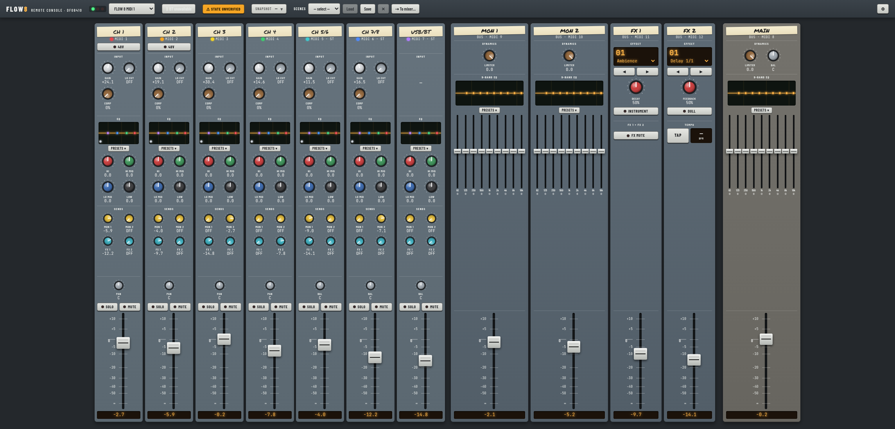

# FLOW 8 Remote

A web app (PWA) for controlling the **Behringer FLOW 8** digital mixer from your computer. The whole
desk fits on one screen like a large studio console: all channels, buses, FX, EQ curves and snapshots.

**Live version:** https://flow.nemesis.megahosting.cz



## Features
- 7 input channels: gain, low cut, compressor, 4-band EQ, pan, MON1/MON2/FX1/FX2 sends,
  mute, solo, 48 V phantom power and fader
- MAIN, MON 1, MON 2 buses (limiter, 9-band graphic EQ), FX 1/FX 2 (preset, parameters)
- EQ curves you can drag; EQ presets (built-in and custom, stored in the browser)
- mixer snapshots 1–15, RESET, FX mute, tap tempo
- scenes stored in the browser, JSON export/import, "Sync ⇢ mixer"
- three themes: *Studio E*, *Vintage*, *Digital*
- motorised-fader style animations, MIDI log
- installable as an app (PWA), works offline

## How it works
The app runs entirely in the browser. It uses **Web MIDI** to send messages to the mixer according
to the official MIDI implementation (FLOW 8 Quick Start Guide, pp. 44–45). The server only hosts
static files; the mixer always talks to the browser on the computer it is plugged into, so nobody
can reach it from outside.

USB MIDI is one-way: the mixer does not report changes made on the desk itself. That is why the app
can also connect over **Bluetooth LE** (the same protocol as the official FLOW Mix app, documented in
[docs/ble-protocol.md](docs/ble-protocol.md)). With Bluetooth connected:
- moves made on the desk show up in the app live,
- the app reads the full mixer state (requests a state dump, which arrives over USB SysEx), so it
  stays in sync even after a snapshot is loaded on the desk,
- things MIDI can't do work too: tap tempo, 48 V phantom power, snapshot load and switching the
  CH 5/6 and CH 7/8 source between LINE and USB.

The top bar shows whether the app reflects the real mixer state (*in sync*, *loaded at …* or
*state unverified*). The FLOW 8 faders are not motorised, so pushing a scene to the mixer asks for
confirmation first.

## Requirements
- Chrome, Edge or Chromium (Web MIDI and Web Bluetooth; Firefox and Safari don't fully support them)
- FLOW 8 connected over USB and switched on; the browser asks for MIDI access on first use
- optional: Bluetooth on the computer for two-way sync

## Usage
1. Open https://flow.nemesis.megahosting.cz in Chrome or Edge.
2. Connect the FLOW 8 over USB. The app finds it automatically (green LED in the top left).
3. Click **Connect BT** to pair over Bluetooth and keep the app in sync with the desk.
4. Optionally install the app (in settings) to run it in its own window, also offline.

Controls: mouse drag, scroll wheel (Shift = fine), double-click = default value, arrow keys,
`T` = tap tempo.

## Development
```bash
npm install
npm run dev       # dev server
npm run check     # type check (svelte-check + tsc)
npm run build     # production build into dist/
```

Svelte 5 + Vite + TypeScript, no other runtime dependencies (fonts are bundled for offline use,
PWA via `vite-plugin-pwa`).

| File | Contents |
|---|---|
| `src/lib/midi-map.ts` | FLOW 8 MIDI map, value conversions (dB, Hz, %) and fader taper |
| `src/lib/mixer.svelte.ts` | mixer state, Web MIDI, scenes, persistence |
| `src/lib/*.svelte` | components: Knob, Fader, EqCurve, ChannelStrip, BusStrip, TopBar… |
| `docs/ble-protocol.md` | reverse-engineered BLE protocol (pairing, messages, scales) |

## Acknowledgements
Inspired by [Flow 8 Web MIDI Control](https://github.com/SpotlightKid/flow8-web-midi-control)
by Christopher Arndt ([SpotlightKid](https://github.com/SpotlightKid)), a browser-based MIDI control
surface for the FLOW 8 ([live demo](https://spotlightkid.github.io/flow8-web-midi-control/)).

## Known limitations
- Channel EQ band frequencies in the graph are approximate (MIDI only controls the gain).
- Without Bluetooth the app doesn't see changes made on the desk. Press *Snapshots › MIDI Dump* on
  the mixer to send the current state to the app over USB.

## License
[MIT](LICENSE)
